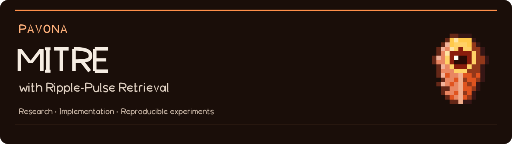

# MITRE with Ripple-Pulse Retrieval

**A research project from PAVONA** exploring how an AI tool can find useful information and return the original evidence behind it.

This repository is the public research workspace for selected retrieval prototypes, benchmark code, and experiment artifacts. It is not the PAVONA application or a packaged release.

## What MITRE is testing

| Component | Role |
| --- | --- |
| **MITRE** | Stores and retrieves memories associated with source records. |
| **Ripple-Pulse Retrieval (RPR)** | Explores how a query can scout relevant memories and return source-linked evidence. |
| **PRISM** | The companion memory-organization concept. Whether it runs, and what work it performs, depends on the experiment. |

The repository includes experiments written in Goose and comparison tools written in Python. **Goose is a programming language, not a name for the retrieval system.**

## Start here

- **[Benchmark protocol](PROTOCOL.md):** Read the historical setup, what was timed, and what was excluded.
- **[Recorded locked-test results](locked_test_analysis_v2.json):** Inspect the recorded comparison. These results belong to that run's workload and settings, not every MITRE/RPR path.
- **[PAVONA](https://pavona.locker):** The project home.

## How to read a result

An index can cover a large collection without reading every record for every query. A cached lookup returning IDs and scores measures a different task from returning source passages and provenance. For a head-to-head comparison, use the same collection, query set, output limit, and timing boundary, then check the answers as well as the time. Report build time, memory, and concurrency separately.

Prefer public or synthetic data when reproducing an experiment. Pin the commit and dependencies, record hashes of the inputs, and save the exact command and output. Report which retrieval path actually ran; a fallback is its own result.

## Contact

For questions about the public research or a specific benchmark, use the repository's [Issues](https://github.com/BDTON/mitre-spark-runner/issues). Include the commit, configuration, and a minimal example with public or synthetic data. Do not post private data, credentials, or internal logs.

Artwork and wordmark: PAVONA.
